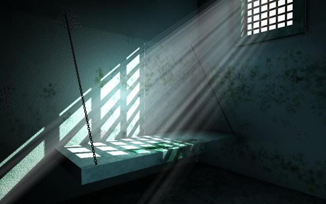

# 🚀 Escape Adventure — *Adventure at Space*

> A text-and-image space adventure game written in Java + JavaFX as a final project for the **Object-Oriented Programming** course at **PUCRS**, in the first semester of 2018.

  
  

> 🗂️ **Archived college project.** This repo is kept as a snapshot of what I could build back then. It is not maintained, and the game is **not finished** (see [Status](#status)).

---

## Project at a glance

| | |
|---|---|
| **Date** | May 28 – July 1, 2018 (2018/1 semester) |
| **Context** | Final assignment ("Trabalho Final 2018/1"), *Programação Orientada a Objetos* |
| **University** | PUCRS — Pontifícia Universidade Católica do Rio Grande do Sul |
| **Professor** | Bernardo Copstein |
| **Team** | João Davila ([@joaodavil4](https://github.com/joaodavil4)), Ana Carolina Dedavid Ferreira, Laura Schmitz Campos Claro |
| **Stack** | Java 8, JavaFX, Eclipse, Astah (class diagram) |
| **Language** | Game text and code identifiers are in Brazilian Portuguese |

## The purpose

The assignment (see [`EnunciadoTF_2018_1.docx`](EnunciadoTF_2018_1.docx)) asked each group to build a simplified **"Adventure"-style game**: a maze of rooms connected by doors, where the player picks up tools, uses them on objects, and solves a mystery to finish the game.

The real goals were to practice:

- **Inheritance and polymorphism**: the professor supplied a small framework (`Sala`, `Objeto`, `Ferramenta`, `Mochila`) and the game had to be *derived* from it.
- **Java collections** (rooms, tools and objects are kept in maps/lists).
- **Reuse and good OO modelling**, with the quality of the class design graded.
- A **graphical interface in JavaFX**: every room shows an image and a text description.

Minimum requirements were 5 rooms, 3 objects and 3 tools, all of which had to matter to the story, plus the ability to save and restore the game from a text file.

## The story

You are an astronaut sent to Mars to repair the **Curiosity** rover. On the way your ship is hit by a meteor shower and you end up inside a **black hole**. From there you have to fix your way out, planet by planet:

| # | Room | Challenge | Tools / objects |
|---|------|-----------|-----------------|
| 1 | **Black Hole** | It's dark. Turn on the flashlight, read the book, power up the GPS. | Flashlight, reading glasses, AA batteries, GPS, *The Hitchhiker's Guide to the Galaxy* |
| 2 | **Saturn** | Out of fuel. Open the sealed jerry can and refill the tank. | Seal opener, fuel can |
| 3 | **Underground Cell** | Captured by Martian "First Order" followers. Climb to the secret hatch and open the padlock. | Ladder, padlock, note with the code, bottle of cachaça |
| 4 | **Guard Room** | Get past a bored Martian guard (cachaça helps) and grab a screwdriver and screw from the toolbox. | Toolbox, guard |
| 5 | **Mars** | Tighten the missing screw on Curiosity and go home. | — |

### Screenshots

These are the room images the game displays in its JavaFX window as you move through the story.

| Start: the spaceship | Black Hole | Saturn |
|:---:|:---:|:---:|
|  |  |  |

| Underground cell | Captured by aliens | The bored guard |
|:---:|:---:|:---:|
|  |  |  |

| Curiosity rover | Mars |
|:---:|:---:|
|  |  |

## How it works

- **`ClassesBasicas/`**: the framework provided by the professor: `Sala` (room), `Objeto`, `Ferramenta` (tool), `Mochila` (backpack).
- **`JogoDemo/`**: our game, derived from those classes.
  - `StageScene`: JavaFX window with the room image, a read-only text area and a command field.
  - `Engine`: builds the maze, tracks the current room and the backpack, and interprets commands.
  - `SalaBlackHole`, `SalaSaturno`, `CelaSubterranea`, `SalaGuardas`, `SalaMarte`: the rooms.
  - `Objetos/` and `Ferramentas/`: the game objects and the tools you can pick up and use.
- [`ClassDiagram0.asta`](ClassDiagram0.asta): class diagram made in Astah.

### Commands

The player types commands in the text field:

| Command | Effect |
|---|---|
| `pegar <ferramenta>` | pick up a tool and put it in the backpack |
| `inventario` | list what's in the backpack |
| `usar <ferramenta>` | use a tool in the current room |
| `sai <sala>` | go through a door to another room |
| `fim` | quit |

## Running it (if you really want to)

This was built with **Eclipse + JavaFX bundled in Oracle JDK 8** (no Maven/Gradle), so it won't build on a modern JDK without adding JavaFX yourself.

1. Use JDK 8 with JavaFX (or newer JDK plus the [OpenJFX](https://openjfx.io/) SDK).
2. Compile `ClassesBasicas/` and `JogoDemo/`.
3. Run `JogoDemo.StageScene` **from the repository root**, since images are loaded with relative paths such as `file:BuracoNegro.jpg`.

## Status

Honest notes about the state of the project, as submitted on July 1, 2018:

- ✅ Rooms 1–4 (Black Hole → Guard Room) are modelled, with images and objects/tools.
- 🚧 `SalaMarte` (the final room) is still a stub, and the ending screen (`TheEnd.jpg`) is never wired up.
- 🚧 Save/restore to a text file (a requirement) was not implemented.
- 🐞 `Engine` still has leftover `System.out.println` calls from the console demo, and a `fechar` case that falls through.
- 🐞 `NoFuel.JPEG` is loaded as `NoFuel.jpg`, which only works on case-insensitive file systems.
- 📦 Compiled `.class` files and a JVM crash log (`hs_err_pid2608.log`) were committed by mistake. There was no `.gitignore` or build tool in place.

## Limitations of the time

It's worth remembering what this was built with and when:

- Collaboration was done through plain Git/GitHub with Eclipse workspaces, so merge commits and committed IDE files are everywhere in the history.
- No build system, no dependency management, no automated tests: just Eclipse "Run".
- JavaFX was still bundled in the JDK, so the project has no declared dependencies.
- Everything in the UI was done by hand in code (no FXML), and game state lives inside the room classes.

## Credits

- Course and framework: Prof. Bernardo Copstein, PUCRS.
- Team: João Davila, Ana Carolina Dedavid Ferreira and Laura Schmitz Campos Claro (see the commit history for who did what).
- Room images were found on the web for this college assignment and belong to their respective authors.
